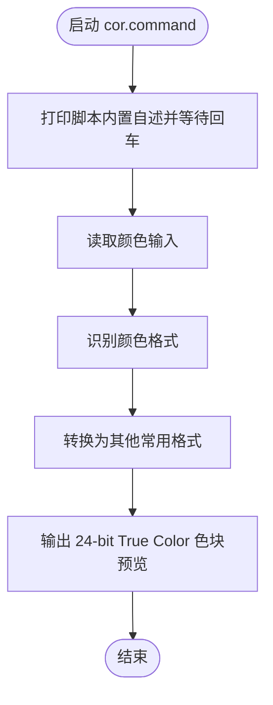

# `【MacOS】🌞颜色格式的转换.command`


<!-- jobs-toc:start -->
<!-- jobs-toc:source {"v":2,"token":"[toc]"} -->
<details>
<summary>📚 目录（点击展开 / 收起）</summary>

- [🔥 前言](#jobs-toc-heading-1)
- [一、功能](#jobs-toc-heading-2)
- [二、支持输入](#jobs-toc-heading-3)
- [三、运行](#jobs-toc-heading-4)
- [四、结构约定](#jobs-toc-heading-5)
- [五、流程图](#jobs-toc-heading-6)
- [六、日志文件](#jobs-toc-heading-7)

</details>
<!-- jobs-toc:end -->

## <span id="jobs-toc-heading-1" data-jobs-toc="v2">🔥 <font id=前言>前言</font></span><!-- jobs-toc:heading-end -->

- 采用 Shell 脚本的原因：Shell 来自 [**macOS**](https://www.apple.com/macos/) 原生系统底层，虽然写法相对繁琐冗杂，但执行效率高，并且不需要额外介入 [**Ruby**](https://www.ruby-lang.org)、[**Python**](https://www.python.org) 等第三方运行环境，因此具备更好的移植性。

## <span id="jobs-toc-heading-2" data-jobs-toc="v2">一、功能 <a href="#前言" style="font-size:17px; color:green;"><b>🔼</b></a> <a href="#🔚" style="font-size:17px; color:green;"><b>🔽</b></a></span><!-- jobs-toc:heading-end -->

转换 HEX / RGB / RGBA / `0xAARRGGBB` 等颜色格式，并在 macOS 终端输出真实色块预览。

Terminal.app、iTerm2、VS Code 终端和 WezTerm 默认使用 24-bit ANSI 色彩；其它终端依据 `COLORTERM` / `TERM` 判断，不匹配真彩色标志时使用 ANSI 256 色近似。Alpha 参与数值转换，色块按 RGB 显示。

## <span id="jobs-toc-heading-3" data-jobs-toc="v2">二、支持输入 <a href="#前言" style="font-size:17px; color:green;"><b>🔼</b></a> <a href="#🔚" style="font-size:17px; color:green;"><b>🔽</b></a></span><!-- jobs-toc:heading-end -->

```zsh
'./【MacOS】🌞颜色格式的转换.command' '#D2D4DE'
'./【MacOS】🌞颜色格式的转换.command' D2D4DE
'./【MacOS】🌞颜色格式的转换.command' '#D2D4DE80'
'./【MacOS】🌞颜色格式的转换.command' D2D4DE80
'./【MacOS】🌞颜色格式的转换.command' '#ABC'
'./【MacOS】🌞颜色格式的转换.command' '#ABCF'
'./【MacOS】🌞颜色格式的转换.command' 'rgb(210,212,222)'
'./【MacOS】🌞颜色格式的转换.command' 'rgba(210,212,222,0.5)'
'./【MacOS】🌞颜色格式的转换.command' '0x80D2D4DE'
'./【MacOS】🌞颜色格式的转换.command' '0xD2D4DE'
```

说明：

- `#RRGGBBAA` / 裸 `RRGGBBAA` 按 `RRGGBBAA` 解析。
- `0xAARRGGBB` 按 Apple / UIKit 常见的 `AARRGGBB` 解析。
- 终端无法真实显示透明背景，Alpha 只参与格式转换；色块按 RGB 原色显示。
- 在 zsh 里直接输入 `#D2D4DE` 会被当作注释，建议加引号，或直接输入裸色值 `D2D4DE`。

## <span id="jobs-toc-heading-4" data-jobs-toc="v2">三、运行 <a href="#前言" style="font-size:17px; color:green;"><b>🔼</b></a> <a href="#🔚" style="font-size:17px; color:green;"><b>🔽</b></a></span><!-- jobs-toc:heading-end -->

双击 `.command` 或终端执行：

```zsh
'./【MacOS】🌞颜色格式的转换.command'
```

如果已经加入 `PATH`，也可以执行：

```zsh
cor
cor D2D4DE
```

## <span id="jobs-toc-heading-5" data-jobs-toc="v2">四、结构约定 <a href="#前言" style="font-size:17px; color:green;"><b>🔼</b></a> <a href="#🔚" style="font-size:17px; color:green;"><b>🔽</b></a></span><!-- jobs-toc:heading-end -->

运行时说明和核心流程位于同名 `.command` 内部，不依赖同级 `README.md`。

本 README 只用于源码浏览、维护说明和当前流程说明。

## <span id="jobs-toc-heading-6" data-jobs-toc="v2">五、流程图 <a href="#前言" style="font-size:17px; color:green;"><b>🔼</b></a> <a href="#🔚" style="font-size:17px; color:green;"><b>🔽</b></a></span><!-- jobs-toc:heading-end -->



## <span id="jobs-toc-heading-7" data-jobs-toc="v2">六、日志文件 <a href="#前言" style="font-size:17px; color:green;"><b>🔼</b></a> <a href="#🔚" style="font-size:17px; color:green;"><b>🔽</b></a></span><!-- jobs-toc:heading-end -->

运行日志默认写入 `$TMPDIR`，文件名通常来自脚本名去掉扩展名：

```shell
$TMPDIR/【MacOS】🌞颜色格式的转换.log
```

<a id="🔚" href="#前言" style="font-size:17px; color:green; font-weight:bold;">我是有底线的➤点我回到首页</a>
