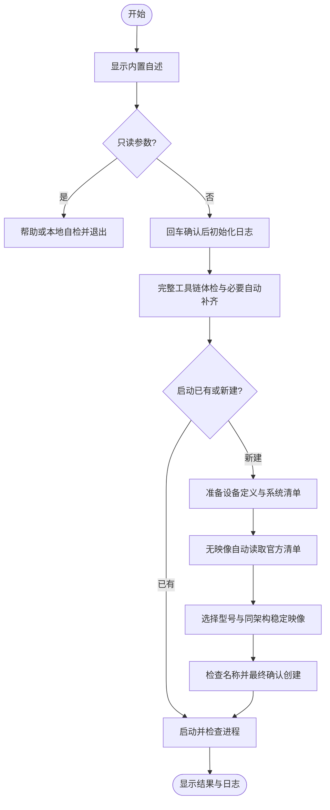

# `【MacOS】🚀双击启动Android模拟器.command`


<!-- jobs-toc:start -->
<!-- jobs-toc:source {"v":2,"token":"[toc]"} -->
<details>
<summary>📚 目录（点击展开 / 收起）</summary>

- [🔥 前言](#jobs-toc-heading-1)
- [一、脚本用途](#jobs-toc-heading-2)
- [二、运行方式](#jobs-toc-heading-3)
- [三、选择、创建与启动](#jobs-toc-heading-4)
- [四、环境与组件修复](#jobs-toc-heading-5)
- [五、注意事项](#jobs-toc-heading-6)
- [六、流程图](#jobs-toc-heading-7)

</details>
<!-- jobs-toc:end -->

---

## <span id="jobs-toc-heading-1" data-jobs-toc="v2">🔥 <font id=前言>前言</font></span><!-- jobs-toc:heading-end -->

- 采用 Shell 脚本的原因：Shell 来自 [**macOS**](https://www.apple.com/macos/) 原生系统底层，虽然写法相对繁琐冗杂，但执行效率高，并且不需要额外介入 [**Ruby**](https://www.ruby-lang.org)、[**Python**](https://www.python.org) 等第三方运行环境，因此具备更好的移植性。
- 本自述文件对应脚本：`【MacOS】🚀双击启动Android模拟器.command`。
- 脚本所属位置：`JobsCommand@Flutter/运行`。
- 脚本定位：启动已有 [**Android**](https://developer.android.com/) 模拟器，或按真实芯片架构选择设备定义和系统映像后新建、启动 AVD。
- 脚本使用系统 `/bin/zsh`、内置自述防误触、纯文本落盘日志、函数化环境自检和 `main "$@"` 收口；单独复制 `.command` 即可运行。
- 首屏回车即授权本次**自动体检、补齐或修复必要工具链**，健康依赖不升级，不再逐层询问是否安装。没有系统映像时自动读取官方清单，选择映像后直接安装；SDK 许可证仍由官方工具交互、本人选择。型号 / 映像 / 名称仍可取消，最终回车才新建设备。
- 只新增设备，不删除、覆盖或重置已有 AVD；不安装 Homebrew，不修改 Shell 启动文件或系统代理。只读检查不会联网或写入脚本日志。

正常自检示例（路径和版本以本机为准）：

```text
✔ SDK：…/Library/Android/sdk
✔ Java：…/Android Studio.app/Contents/jbr/Contents/Home/bin/java
✔ SDK 命令行工具：…/sdk/cmdline-tools/latest/bin
✔ emulator：…/sdk/emulator/emulator
✔ 已装匹配架构的手机 / 平板系统映像：1 个
✔ 创建依赖已就绪。
```

## <span id="jobs-toc-heading-2" data-jobs-toc="v2">一、脚本用途 <a href="#前言" style="font-size:17px; color:green;"><b>🔼</b></a> <a href="#🔚" style="font-size:17px; color:green;"><b>🔽</b></a></span><!-- jobs-toc:heading-end -->

| 项目 | 说明 |
|---|---|
| 脚本名称 | `【MacOS】🚀双击启动Android模拟器.command` |
| 所属目录 | `JobsCommand@Flutter/运行` |
| 主要标签 | Android、AVD、SDK、模拟器 |
| 是否涉及 Homebrew | 否；可用 fzf 仅作为选择增强，缺失 / 损坏时使用编号 |
| 是否可能联网 | 首屏回车授权后，必要时自动补齐工具链、读取官方清单、安装选中映像 |
| 是否含高风险命令 | 不删除或覆盖已有 AVD，不执行全量升级 / 清理 |
| 验证方式 | `zsh -n`、真实环境 `--check`、隔离假 SDK 回归；真实安装 / 创建设备单独验收 |

## <span id="jobs-toc-heading-3" data-jobs-toc="v2">二、运行方式 <a href="#前言" style="font-size:17px; color:green;"><b>🔼</b></a> <a href="#🔚" style="font-size:17px; color:green;"><b>🔽</b></a></span><!-- jobs-toc:heading-end -->

推荐双击 `.command` 运行。终端方式如下：

```shell
/bin/zsh './【MacOS】🚀双击启动Android模拟器.command'
```

脚本启动后先显示源码中写死的内置自述，再等待回车继续；不会在运行时读取本 README。非空输入取消，`Ctrl+C` 随时停止。无交互终端只允许 `--check` / `--help`。

| 参数 | 行为 |
| --- | --- |
| 无参数 | 已有 AVD 时选择新建或启动；没有 AVD 时进入可取消的新建选择 |
| `--create` | 直接进入新建交互；桌面右键入口固定使用此参数 |
| `--prepare` | 首屏回车后仅自动体检、补齐与复检工具链，完成退出；不查询映像或创建设备 |
| `--check` | 不等待确认；只检查 SDK、Java、工具、已有 AVD 和已装同架构映像，不联网、不修复、不写脚本日志 |
| `--help` | 显示帮助，不探测环境或写日志 |

```shell
/bin/zsh './【MacOS】🚀双击启动Android模拟器.command' --check
/bin/zsh './【MacOS】🚀双击启动Android模拟器.command' --prepare
/bin/zsh './【MacOS】🚀双击启动Android模拟器.command' --create
```

## <span id="jobs-toc-heading-4" data-jobs-toc="v2">三、选择、创建与启动 <a href="#前言" style="font-size:17px; color:green;"><b>🔼</b></a> <a href="#🔚" style="font-size:17px; color:green;"><b>🔽</b></a></span><!-- jobs-toc:heading-end -->

1、按 `ANDROID_HOME` → `ANDROID_SDK_ROOT` → 用户标准 SDK 目录确定唯一 SDK；两项环境变量冲突时使用 `ANDROID_HOME`，仅对本次进程及其子进程统一。

2、按 SDK 根目录 → Java → `sdkmanager` / `avdmanager` → emulator 完整检查工具链。命令路径存在后仍进行版本或只读状态体检；健康层复用，缺失或损坏层自动修复一次并立即复检，失败停止后续操作并显示阶段、退出码和日志。

3、设备型号来自当前 SDK 自带定义，保留手机 / 平板及通用移动设备，排除明确的 Watch / Wear、TV、汽车和桌面定义；Pixel 手机优先，版本按自然次序排列，不固定三款旧机型。

4、根据真实硬件选择 `arm64-v8a` 或 `x86_64`；Apple Silicon 的 Rosetta 终端仍使用 ARM 映像。优先选择完整已装系统，可另选 Google 官方可下载稳定清单；支持稳定 minor / extension API，过滤 preview、异构映像和非手机 / 平板映像。

5、可用 [**fzf**](https://github.com/junegunn/fzf) 支持搜索，健康检查失败或运行异常降级编号；回车均采用首项，`q` / `Esc` 取消，空清单不进入无效编号交互。

6、名称只接受 1–80 位安全 ASCII 字符，不接受路径或空白。显示创建组合后最后回车确认；创建前再次检查同名配置、目录和列表，已有或损坏 AVD 都不强制覆盖。

7、创建成功还会复查 AVD 列表，再后台启动 emulator。启动后仅确认进程仍在运行，Android 开机需要继续等待；终端关闭不会主动停止模拟器。

## <span id="jobs-toc-heading-5" data-jobs-toc="v2">四、环境与组件修复 <a href="#前言" style="font-size:17px; color:green;"><b>🔼</b></a> <a href="#🔚" style="font-size:17px; color:green;"><b>🔽</b></a></span><!-- jobs-toc:heading-end -->

- 首屏回车授权后，不存在的 SDK 根目录自动建立；路径不是普通绝对目录时明确停止，保留原有内容。可参考 [**Android Studio SDK Manager**](https://developer.android.com/studio/intro/update#sdk-manager) 官方说明。`--check` 始终不会建立目录或修复。
- Java 优先复用配置项、Android Studio 内置 JBR、用户级 JDK 和系统安装，健康版本至少 17；全部不可用才自动安装匹配宿主架构的 [**Eclipse Temurin 21**](https://adoptium.net/installation/archives/)。仅访问 Adoptium 官方 API、Temurin 官方发布仓与受控 GitHub 资产主机，校验版本、架构、长度与 SHA256，在当前用户 Java 目录同卷 `0700` 临时目录解压，检查路径与链接边界，再排他发布独立版本；不改全局环境或 Shell 配置。SDK 报 Java class 版本不兼容时自动选择 / 补齐 Java 21 并重试原工具一次，仍失败即停止；[官方 JDK 兼容说明](https://developer.android.com/build/jdks)。
- 缺失 / 损坏命令行工具自动从 `https://dl.google.com/android/repository/repository2-3.xml` 选择 stable、匹配宿主架构的 macOS 归档；curl 禁用用户配置、不跟随重定向，保留环境代理，显示下载进度，校验官方长度及 SHA-1 / SHA-256，检查 ZIP 路径和符号链接后解压。下载与解压使用 SDK `cmdline-tools/` 下权限 `0700` 的本次临时目录，最终同卷排他移动到随机命名的 `jobs-版本-随机后缀` 目录；目标存在即失败，不嵌入或覆盖既有目录。私有临时目录结束后精确清理；一次安装后复检，失败立即停止。
- 缺失 emulator 或选中映像尚未安装时，打印 Google 官方软件源、包 ID 和目标 SDK，自动由 `sdkmanager --install` 安装精确组件，保留官方许可证交互，不使用 `yes` 自动接受，不执行 `--update` 全量升级。若 emulator 已存在或已被 SDK 登记却损坏，仅由官方管理器卸载、重装 emulator 工具包一次，保留 AVD 与系统映像；复检失败明确停止，健康环境不安装或升级。
- 来源日志示例：

  ```text
  ━━━━━━━━━━ 来源｜SDK 组件安装 ━━━━━━━━━━
  📦 对象：system-images;android-36;google_apis;arm64-v8a（stable channel 0）
  🌐 平台 / 软件源：Google 官方 Android SDK Repository
  📥 来源地址：https://dl.google.com/android/repository/（具体归档地址由 sdkmanager 解析，尚未核实）
  📂 目标位置：当前选定 SDK
  ```

- 兼容现有 SDK 工具链。[**sdkmanager**](https://developer.android.com/tools/sdkmanager)、[**avdmanager**](https://developer.android.com/tools/avdmanager) 和 [**emulator 命令行**](https://developer.android.com/studio/run/emulator-commandline) 官方文档已推荐迁移 Android CLI，本脚本保留仍受文档描述的既有调用，不擅自替换本机 SDK 管理方式。

## <span id="jobs-toc-heading-6" data-jobs-toc="v2">五、注意事项 <a href="#前言" style="font-size:17px; color:green;"><b>🔼</b></a> <a href="#🔚" style="font-size:17px; color:green;"><b>🔽</b></a></span><!-- jobs-toc:heading-end -->

- 2026-10-23：隔离回归 50 组 / 356 断言通过，并真实运行 `--prepare` 验证一次首屏授权后自动补齐。Google 官方 ARM Command-line Tools 23.0 约 155 MB 归档经长度 / 摘要核对后安装到 SDK 独立版本目录，sdkmanager / avdmanager / emulator 复检通过；健康 SDK 与 Java 21 直接复用。未下载系统映像、接受 SDK 许可证或创建 / 启动真实 AVD。
- 首次运行前建议先阅读本 README，再执行脚本。
- 无需传入业务工程目录，所有工具和映像都绑定选定 SDK；存在自定义 AVD 环境变量时沿用工具的配置。
- 下载失败、许可证拒绝、磁盘 / 权限不足时明确停止，可修复后重新执行；脚本不清理失败安装或创建留下的 SDK / AVD 内容，请在 Device Manager 中人工核实。
- 运行日志在系统临时目录，文件名为 `脚本名.进程号.log`；模拟器输出单独写入 `脚本名.进程号.AVD名.emulator.log`。确认前和只读入口不建日志，日志保持纯文本。
- 双击入口与 Finder 功能包的 `Scripts/CreateAndroidSimulator.zsh` 保持逐字节一致，各自均可独立拷走；Finder 是否显示菜单由扩展负责，脚本只处理模拟器业务。

## <span id="jobs-toc-heading-7" data-jobs-toc="v2">六、流程图 <a href="#前言" style="font-size:17px; color:green;"><b>🔼</b></a> <a href="#🔚" style="font-size:17px; color:green;"><b>🔽</b></a></span><!-- jobs-toc:heading-end -->



<a id="🔚" href="#前言" style="font-size:17px; color:green; font-weight:bold;">我是有底线的➤点我回到首页</a>
