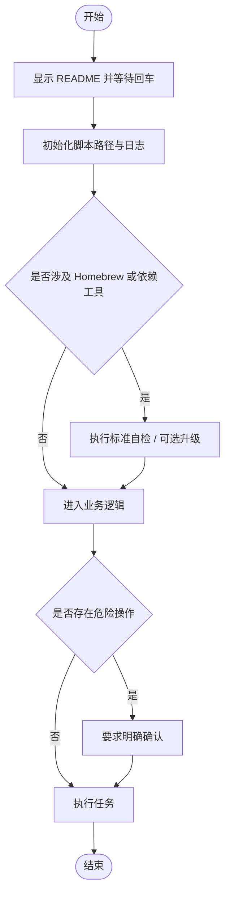

# `【MacOS】⚙️一键配置Flutter项目至运行.command`


<!-- jobs-toc:start -->
<!-- jobs-toc:source {"v":2,"token":"[toc]"} -->
<details>
<summary>📚 目录（点击展开 / 收起）</summary>

- [🔥 前言](#jobs-toc-heading-1)
- [一、脚本用途](#jobs-toc-heading-2)
- [二、运行方式](#jobs-toc-heading-3)
- [三、本次升级内容](#jobs-toc-heading-4)
- [四、Homebrew 标准](#jobs-toc-heading-5)
- [五、注意事项](#jobs-toc-heading-6)
- [六、流程图](#jobs-toc-heading-7)

</details>
<!-- jobs-toc:end -->

> **Python 环境预检**：实际调用 [**Python**](https://www.python.org/) 前使用本文件内嵌的环境预检函数，通过 [**Homebrew**](https://brew.sh/) 管理运行时；脚本可单文件复制运行，不需要旁边的支持目录。终端自述确认后执行 `brew update` 更新本体及公式索引；只在指定公式 `python@3.13` 缺失、损坏或版本不满足 `3.11+` 时安装或修复，健康运行时直接复用。缺失 Homebrew 时强提示选安装路径：精确大写 `YES` 选系统标准目录，其它输入或回车选用户目录；失败停止，不自动换路。必需安装或修复直接回车执行，任意非空输入（含空格）取消。预检不执行全局 `brew upgrade`。

## <span id="jobs-toc-heading-1" data-jobs-toc="v2">🔥 <font id=前言>前言</font></span><!-- jobs-toc:heading-end -->

- 脚本入口使用 macOS 原生 Shell；其中的解析、转换或服务功能需要下述已验证的 Python 运行时。

- 本自述文件对应脚本：`【MacOS】⚙️一键配置Flutter项目至运行.command`。
- 脚本原始位置：`JobsGenesis@JobsCommand.Flutter/配置相关`。
- 脚本定位：执行该脚本文件名对应的 macOS 自动化任务。
- 本次已按 Jobs 标准升级：`# shell: zsh`、README 防误触、彩色日志、结构化入口、`main "$@"` 收口。
- 普通安装 / 更新 / 升级交互统一为：**回车跳过，输入任意字符后回车执行**。
- 危险操作不应该靠回车默认执行；涉及破坏性修改时，应单独输入 `YES` 确认。

## <span id="jobs-toc-heading-2" data-jobs-toc="v2">一、脚本用途 <a href="#前言" style="font-size:17px; color:green;"><b>🔼</b></a> <a href="#🔚" style="font-size:17px; color:green;"><b>🔽</b></a></span><!-- jobs-toc:heading-end -->

| 项目 | 说明 |
|---|---|
| 脚本名称 | `【MacOS】⚙️一键配置Flutter项目至运行.command` |
| 所属目录 | `JobsGenesis@JobsCommand.Flutter/配置相关` |
| 主要标签 | `通用脚本` |
| 是否涉及 Homebrew | `是` |
| 是否可能联网 | `是` |
| 是否含高风险命令 | `否` |
| zsh 静态检查 | `zsh -n 已通过；未执行真实安装、更新或业务` |

## <span id="jobs-toc-heading-3" data-jobs-toc="v2">二、运行方式 <a href="#前言" style="font-size:17px; color:green;"><b>🔼</b></a> <a href="#🔚" style="font-size:17px; color:green;"><b>🔽</b></a></span><!-- jobs-toc:heading-end -->

推荐双击 `.command` 运行。终端方式如下：

```shell
chmod +x './【MacOS】⚙️一键配置Flutter项目至运行.command'
'./【MacOS】⚙️一键配置Flutter项目至运行.command'
```

脚本启动后会先显示本 README，并等待回车继续，避免误触执行。

## <span id="jobs-toc-heading-4" data-jobs-toc="v2">三、本次升级内容 <a href="#前言" style="font-size:17px; color:green;"><b>🔼</b></a> <a href="#🔚" style="font-size:17px; color:green;"><b>🔽</b></a></span><!-- jobs-toc:heading-end -->

- 统一脚本解释器为 `# shell: zsh`。
- 增加 README 展示与回车阻塞，防止双击误操作。
- 增加 Jobs 标准彩色日志函数，日志路径为 `$TMPDIR/脚本名.log`。
- 增加 `SCRIPT_DIR` / `SCRIPT_PATH` 标准路径变量。
- 使用 `main "$@"` 作为统一入口。
- 原业务逻辑保留在 `run_original_logic` 模块内，方便后续继续拆分重构。
- 脚本内嵌 Homebrew 健康自检函数：架构判断、安装路径选择、shellenv 注入、当前会话生效和更新。

## <span id="jobs-toc-heading-5" data-jobs-toc="v2">四、Homebrew 标准 <a href="#前言" style="font-size:17px; color:green;"><b>🔼</b></a> <a href="#🔚" style="font-size:17px; color:green;"><b>🔽</b></a></span><!-- jobs-toc:heading-end -->

- Python 运行前经终端确认执行内嵌 Homebrew 自检与 `brew update`；既有其它工具维护选项保留，不因目录只读而自动另装。
- [**Homebrew**](https://brew.sh/) 安装路径由用户选择：已有可运行安装时复用；确实需要安装时先强提示，只有精确输入大写 `YES` 才选择系统标准目录，其它输入或直接回车选择当前用户的 `.local/homebrew`。`YES` 只表示选择路径，权限与密码由官方安装器实际处理；有管理员权限也可以选用户目录。选定路径失败立即停止，不自动切换；`Ctrl+C` / 输入结束取消整个任务。
- 用户目录安装需要可用 Git 与 curl；后续系统级软件仍可能要求管理员权限。

## <span id="jobs-toc-heading-6" data-jobs-toc="v2">五、注意事项 <a href="#前言" style="font-size:17px; color:green;"><b>🔼</b></a> <a href="#🔚" style="font-size:17px; color:green;"><b>🔽</b></a></span><!-- jobs-toc:heading-end -->

- 我没有在生成阶段执行脚本里的 macOS 专属命令，例如 `brew`、`pod`、`flutter`、`xcodebuild`、`osascript`、`sudo`、模拟器控制等。
- 首次运行前建议先阅读本 README，再执行脚本。
- 如果脚本涉及工程目录，请确认当前目录或拖入路径正确。
- 如果脚本涉及 Git / CocoaPods / Flutter 依赖更新，建议先提交或备份本地改动。
- 运行日志默认写入：`$TMPDIR/【MacOS】⚙️一键配置Flutter项目至运行.log`。

## <span id="jobs-toc-heading-7" data-jobs-toc="v2">六、流程图 <a href="#前言" style="font-size:17px; color:green;"><b>🔼</b></a> <a href="#🔚" style="font-size:17px; color:green;"><b>🔽</b></a></span><!-- jobs-toc:heading-end -->



<a id="🔚" href="#前言" style="font-size:17px; color:green; font-weight:bold;">我是有底线的➤点我回到首页</a>
